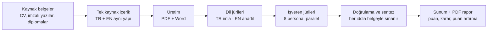

# Kariyer Kurulu

**Çok ajanlı CV hazırlama, inceleme ve kariyer yönetimi sistemi.**
*Career Board: a multi-agent system that writes a CV in two languages and puts it in front of ten simulated hiring juries.*

> Bir CV'yi yazan kişi her zaman iyi görür. Asıl soru: onu okuyacak kurum nasıl görüyor?

Kariyer Kurulu, bir kişinin belgelerinden Türkçe ve İngilizce, eşit kalitede bir CV üretir. Sonra bu CV'yi iki dil jürisine ve sektöre göre seçilen sekiz işveren jürisine sokar. Her jüri aynı puan kartıyla puanlar ve bir karar verir. Jürilerin iddiaları kaynak belgeyle doğrulanır ve sonuç bir sunum olarak teslim edilir.

---

## Nasıl çalışır



| Katman | Ne yapar | Model |
|---|---|---|
| 1. Kaynak envanteri | Her tarih, unvan, rakam bir belgeye bağlanır | Opus |
| 2. Tek kaynak içerik | TR ve EN aynı dosyadan; yapı eşitliği otomatik denetlenir | Opus |
| 3. Dil jürileri | Türkçe imla ve resmî dil; İngilizcede birebir çeviri kokusu | Opus |
| 4. İşveren jürileri | 8 persona aynı 7 kriterle puanlar, karar verir | Sonnet (paralel) |
| 5. Doğrulama ve sentez | Jüri iddiaları belgeyle sınanır, ısı haritası, senaryolar | Opus |

## Jüri paneli

| # | Persona | Değerlendirdiği rol (örnek) |
|---|---|---|
| 1 | Türkiye kamu kurumu | Kıdemli teknik müşavir |
| 2 | Türkiye özel sektör grubu | Teknik / bölge direktörü |
| 3 | Uluslararası yüklenici (EPC) | İnşaat ve kalite müdürü |
| 4 | Körfez ulusal şirketi | Kıdemli danışman |
| 5 | Avrupa operatörü | Proje direktörü |
| 6 | Komşu sektör holdingi | Modernizasyon direktörü |
| 7 | Uluslararası headhunter | Üst yönetim aday listesi |
| 8 | ATS + 7 saniye taraması | İlandaki unvan |

**Puan kartı (1–10):** İlk 7 saniye · Rol uyumu · Kanıt · Güncellik · Teknik derinlik · Liderlik · Sunum ve dil
**Karar:** Mülakata çağır · Beklemeye al · Ele

Personalar sektöre göre değişir. Ayrıntı: [docs/02-juri-paneli.md](docs/02-juri-paneli.md)

## Gerçek bir çalışmadan (anonim)

Kıdemli bir mühendis-yönetici CV'si sistemden geçti:

- **34** dil bulgusu incelendi, **27**'si uygulandı; 7'si gerekçesiyle reddedildi.
- **8** işveren jürisinden **5**'i mülakata çağırdı, **3**'ü beklemeye aldı, eleyen olmadı. Panel ortalaması **6,5 / 10**.
- En güçlü kriter teknik derinlik (**7,6**), en zayıf kriter kariyer sürekliliği (**4,9**).
- "Jüriye de jüri": bir jürinin "PDF'te karakterler bozuk" iddiası test edildi; sorun jürinin kendi ekranındaydı. Bir başka jürinin resmî proje adını "düzeltme" önerisi imzalı belgeyle karşılaştırılıp reddedildi.
- Puan artırma senaryoları: bugün 6,5 → yeni bilgi gerektirmeyen hızlı paket ~6,9 → tam paket ~7,9 (tahmini).

Tamamen kurgusal bir örnek aday ve jüri çıktısı: [examples/ornek-aday](examples/ornek-aday)

## İçerik

```
skills/kariyer-kurulu/SKILL.md   Claude için skill: tüm aşamalar ve kurallar
docs/                            Yöntem, jüri paneli, model ataması, gizlilik
prompts/                         Dil jürisi, işveren jürisi ve doğrulama istemleri
builder/                         Tek kaynaktan PDF (Typst) + DOCX üreten betikler
examples/ornek-aday/             Kurgusal aday: içerik, jüri sonuçları, rapor
linkedin/                        Paylaşım metni ve tanıtım karuseli
```

## Hızlı başlangıç

```bash
# 1) Skill'i Claude Code'a ekleyin
cp -r skills/kariyer-kurulu ~/.claude/skills/

# 2) Örnek CV'yi üretin (Python 3.11+, python-docx, Typst)
pip install python-docx
python builder/build_cv.py examples/ornek-aday out/
typst compile out/Ornek_Aday_CV_TR.typ out/Ornek_Aday_CV_TR.pdf
```

Claude Code'da: *"Kariyer Kurulu skill'ini aç. Ekteki CV ve belgelerden TR/EN CV hazırla, sonra enerji sektörü için jüri panelini çalıştır."*

## İlkeler

1. **Kaynak yoksa bilgi yok.** Hiçbir tarih ya da rakam uydurulmaz.
2. **İmzalı belge esastır**; beyanla çelişki kişiye gösterilir.
3. **Kişinin tercihi puandan önce gelir.**
4. **Jüri de yanılabilir**; her öneri doğrulanır.
5. **Simülasyon simülasyondur**; gerçek kurum görüşü gibi sunulmaz.

Ayrıntı: [docs/04-gizlilik-ve-etik.md](docs/04-gizlilik-ve-etik.md)

## Hizmet

Neleri göndermeniz gerektiğini, bunların neye dönüştüğünü ve size ne teslim edildiğini anlatan 12 sayfalık rehber: [docs/kariyer-kurulu-basvuru-rehberi.pdf](docs/kariyer-kurulu-basvuru-rehberi.pdf)

Bu sistemle kendi CV'nizin hazırlanmasını ya da mevcut CV'nizin hedeflediğiniz kurumların gözünden değerlendirilmesini isterseniz GitHub üzerinden bir issue açabilir ya da LinkedIn'den ulaşabilirsiniz.

## Lisans

MIT. Bkz. [LICENSE](LICENSE).
